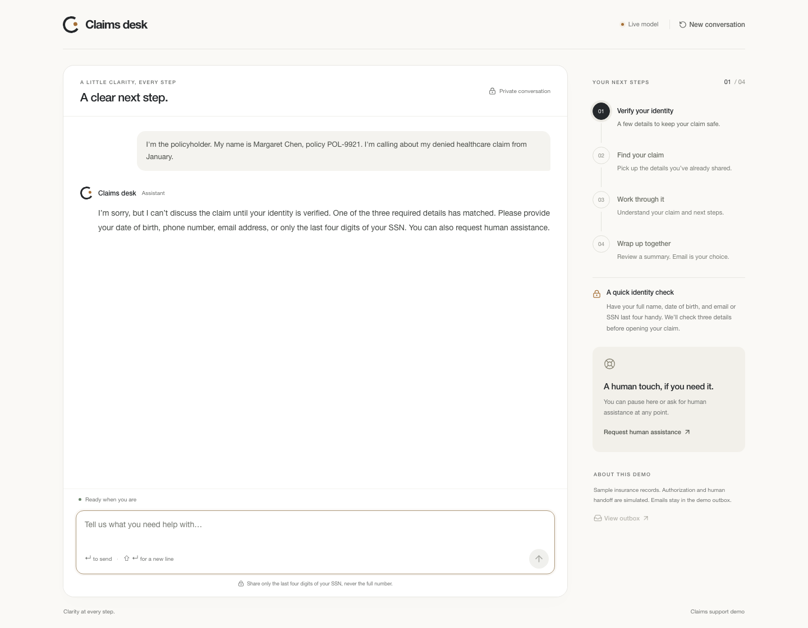
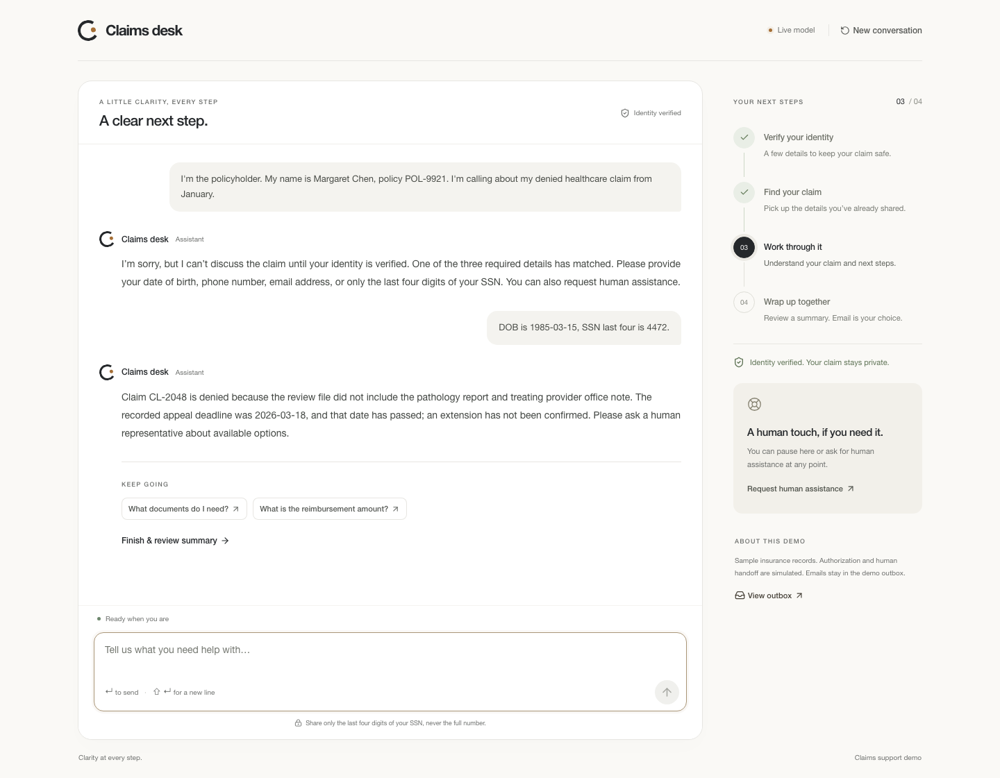
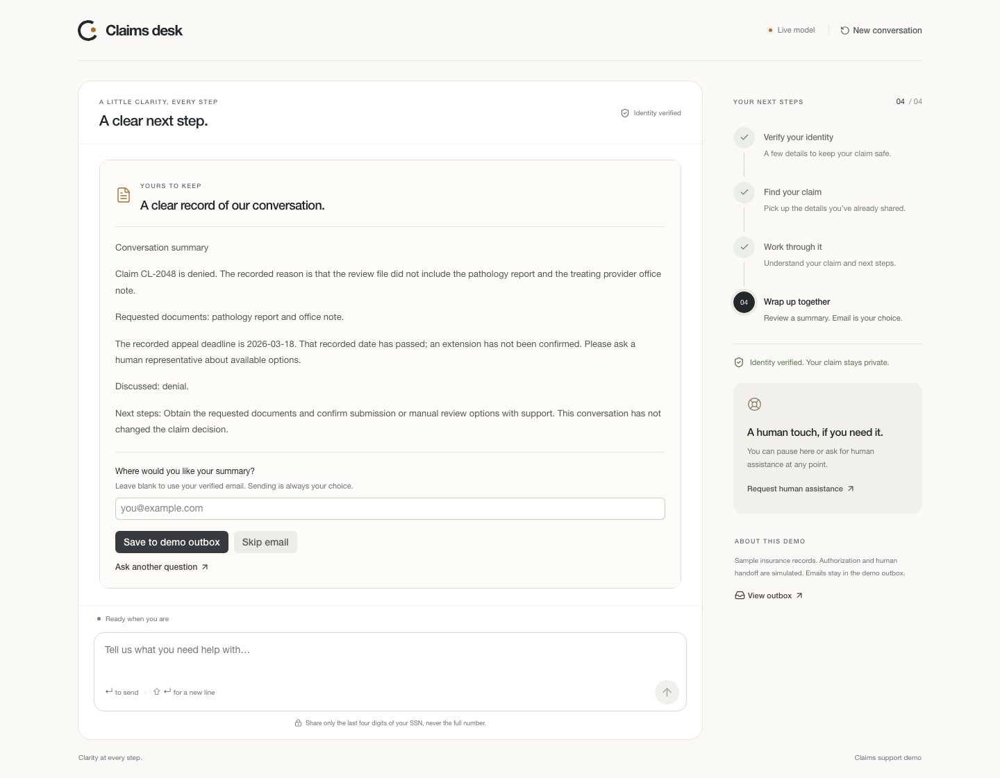
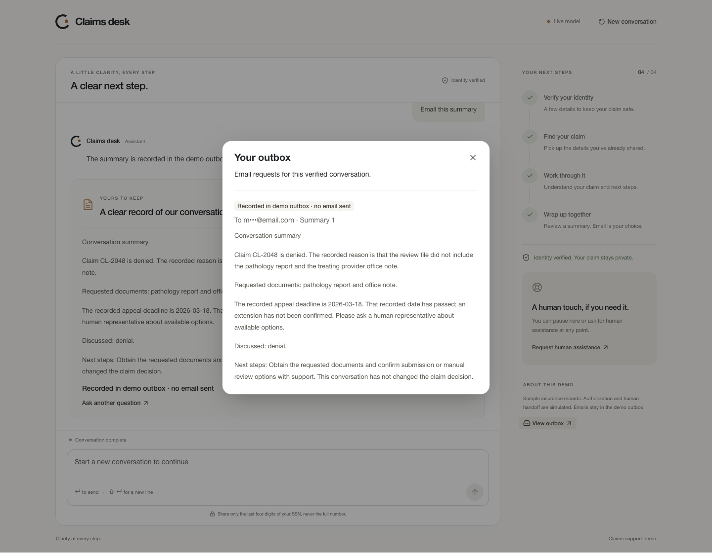
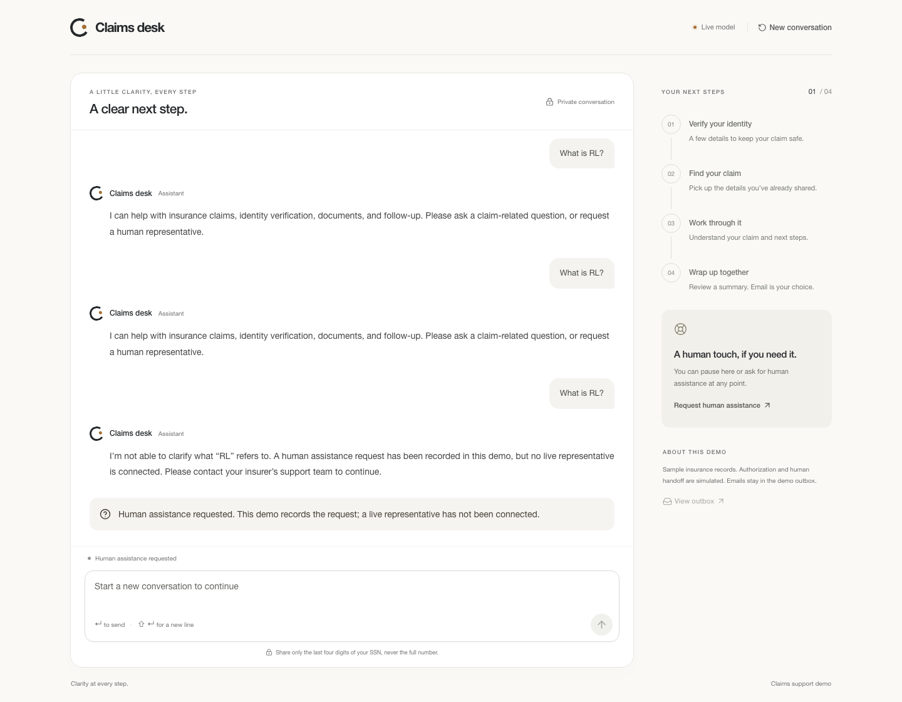
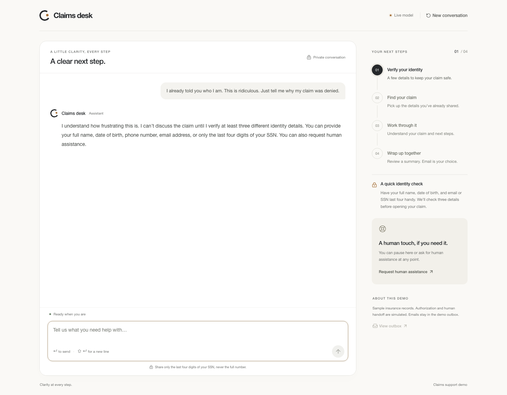

# ClaimFlow

An insurance claims support agent with a four-stage workflow: identity verification → intent resolution → claim processing → follow-up.

## Setup

Requires **Bun 1.2.18+** and an API key for your chosen model.

From the repository root:

```sh
bun install --frozen-lockfile
cp -n .env.example .env
```

Set your model credentials in `.env` (the file stays local and is ignored by Git):

```dotenv
AGENT_MODE=live
MODEL_PROVIDER=openai
MODEL_ID=gpt-6-luna
MODEL_API_KEY=your-api-key
```

Use a model your API key can access. The app supports `openai`, `anthropic`, and `openai-compatible`; the latter also requires `MODEL_BASE_URL`. Native providers use the model catalog pinned in the SDK. Other settings are in [.env.example](.env.example).

```sh
bun run dev
```

Open **http://127.0.0.1:3000**. Choose **Try a sample conversation**, send the prefilled message, and ask a follow-up such as “What documents do I need?” Then select **Finish & review summary** and choose **Save to demo outbox** or **Skip email**.

The default email mode saves to a local outbox; it sends no real email. Authorization and human handoff are simulated.

For an offline walkthrough without an API key, run `bun run dev:demo`. This explicitly uses scripted responses; use live mode to review natural-language behavior.

To verify the setup:

```sh
bun run check       # Formatting, typecheck, and tests
bun run smoke:http  # With the app running: verify → claim answer → summary → skip
```

<details>
<summary>Run with Docker instead</summary>

Configure `.env` as above, then run:

```sh
docker build -t claimflow .
docker run --rm --name claimflow -p 127.0.0.1:3000:3000 \
  --env-file .env -e HOST=0.0.0.0 \
  -e SESSION_DB_PATH=/app/.data/sessions.sqlite \
  -v claimflow-data:/app/.data claimflow
```

Open **http://127.0.0.1:3000**. Add `-e AGENT_MODE=demo` to the run command for offline mode. Run one application process per database; restarting starts fresh conversations.

</details>

## Screenshots

Captured in live mode using the supplied sample records and mock email. These examples follow the [brief](docs/brief.md); model wording may vary.

**1. Identity verification.** The caller provides a name and an early claim hint. The agent asks for more identity details and stays in verification without disclosing claim information.



**2. Remembered intent and grounded claim processing.** After the caller supplies DOB and SSN last four, three distinct identity fields match. The agent reuses the earlier hint to find CL-2048 and explains the denial from the claim record.



**3. Summary and consent.** The final phase shows the discussion, claim outcome, and next steps. Saving the summary or skipping email is the caller’s choice.



<details>
<summary>Completed delivery, scope limits, and emotional support</summary>

**Demo outbox.** After explicit consent, the summary appears in the outbox with a masked recipient and a clear notice that no real email was sent.



**Scope limits.** Repeated “What is RL?” questions receive insurance-only redirection, followed by a simulated human-assistance request.



**Emotional support (bonus).** A frustrated caller receives empathy and verification options while claim details remain protected.



</details>
